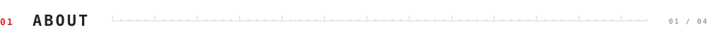

<!-- Hero, section headers and footer are generated: edit tools/build_assets.py, then run it. -->

<a href="https://automatlog.in">
<picture>
  <source media="(prefers-color-scheme: dark)" srcset="https://raw.githubusercontent.com/automatlog/automatlog/main/assets/hero-dark.svg">
  
</picture>
</a>
 

  
  
  
  
  

<h3>
<picture>
  <source media="(prefers-color-scheme: dark)" srcset="https://raw.githubusercontent.com/automatlog/automatlog/main/assets/section-01-dark.svg">
  
</picture>
</h3>

I work where AI agents meet security: I build multi-agent and RAG systems, and I threat-model the tools those agents are allowed to call.

- **Software Developer at Smart Technology** — Engineering forward-deployed CPaaS, AI agent tooling, and cloud platforms.
- **AI & Agent Security Researcher** — Focused on Model Context Protocol (MCP) servers & agentic security: tool poisoning, schema poisoning, confused-deputy attacks, and prompt misuse.
- **OAuth & IAM Architecture** — Architected unified OAuth hubs across 6+ platforms (Zoho, HubSpot, Shopify, Razorpay) and multi-channel pipelines (WhatsApp, SMS, RCS).
- **GenAI & RAG Systems** — Implemented production RAG pipelines with Python, PyTorch, HuggingFace Transformers, vLLM, pgvector, and LangGraph orchestration.
- **Building [Automate](https://automateplatform.in) on the side** — an AI-agent automation platform with a visual chatbot builder and multi-agent orchestration.
- **B.Tech CSE (Cybersecurity & Networking)** — ITM-SLS Baroda University · Vadodara, Gujarat
- **Community** — Management Lead at GDSC ITMBU · Student Ambassador at DeepLearning.AI · AWS User Group Vadodara.

<h3>
<picture>
  <source media="(prefers-color-scheme: dark)" srcset="https://raw.githubusercontent.com/automatlog/automatlog/main/assets/section-02-dark.svg">
  
</picture>
</h3>

| Area | Tools |
| :-- | :-- |
| **AI & agents** |    `LangGraph` `vLLM` `HuggingFace Transformers` `pgvector` `Model Context Protocol` |
| **Security** |    `OWASP Top 10` `Burp Suite` `PortSwigger Academy` `Wireshark` `Nmap` `Microsoft Sentinel` |
| **Cloud & DevOps** |  |
| **Languages** |  |
| **Frameworks & mobile** |    `React Native` `Expo` `WebRTC` `FreeSWITCH` `OAuth 2.0` |
| **Databases** |  |
| **Tools** |  |

<h3>
<picture>
  <source media="(prefers-color-scheme: dark)" srcset="https://raw.githubusercontent.com/automatlog/automatlog/main/assets/section-03-dark.svg">
  
</picture>
</h3>

<table>
<tr>
<td width="50%" valign="top">
<h3>Automate</h3>
AI AUTOMATION &nbsp;·&nbsp; 2026

AI-agent automation platform featuring a <b>visual chatbot builder</b>, multi-agent orchestration with an intelligent routing layer, centralized management console, embeddable widgets, human-like face agents, and adaptive interaction-based learning.

<code>LangGraph</code> <code>vLLM</code> <code>pgvector</code> <code>React</code>

</td>
<td width="50%" valign="top">
<h3>AI Agent &amp; MCP Security Research</h3>
AI SECURITY &nbsp;·&nbsp; RESEARCH &nbsp;·&nbsp; 2026

Independent threat-modeling research on <b>Model Context Protocol (MCP)</b> servers in agentic AI. Auditing tool poisoning, schema manipulation, confused-deputy attack surfaces, and tool-permission misuse mapped directly to CVEs and MCP specifications.

<code>MCP</code> <code>OWASP</code> <code>Python</code> <code>CVE mapping</code>

</td>
</tr>
<tr>
<td width="50%" valign="top">
<h3>AI Connector</h3>
AI &nbsp;·&nbsp; CDN + SDK &nbsp;·&nbsp; 2026

Embeddable AI widget shipped as a <b>CDN script</b> and an <b>SDK</b>, backed by a connector that links LLM providers (<b>OpenAI, Anthropic, Gemini, DeepSeek</b>), each with its own API key and default model.

<code>CDN</code> <code>SDK</code> <code>OpenAI</code> <code>Anthropic</code> <code>Gemini</code> <code>DeepSeek</code>

</td>
<td width="50%" valign="top">
<h3>OSINT Security Suite</h3>
SECURITY &nbsp;·&nbsp; OSINT &nbsp;·&nbsp; 2026

Full-stack OSINT reconnaissance and threat scanning platform built with <b>React & Python</b>. Features automated intelligence gathering, dynamic PDF threat reporting pipelines, and zero-plaintext credential handling with environment-based secret isolation.

<code>Python</code> <code>React</code> <code>OSINT</code> <code>AppSec</code>

</td>
</tr>
<tr>
<td width="50%" valign="top">
<h3>Mobile App</h3>
CPAAS &nbsp;·&nbsp; ANDROID &amp; IOS &nbsp;·&nbsp; 2026

CPaaS solution delivered on <b>Android & iOS (React Native, Expo)</b> with webhook-driven WhatsApp, SMS, and RCS pipelines, WebRTC voice signaling over FreeSWITCH, and consolidated OAuth 2.0 multi-provider token management.

<code>React Native</code> <code>Expo</code> <code>WhatsApp</code> <code>RCS</code> <code>WebRTC</code> <code>FreeSWITCH</code> <code>Firebase</code>

</td>
<td width="50%" valign="top">
<h3>Shopify/Ecommerce Automation</h3>
ECOMMERCE &nbsp;·&nbsp; AUTOMATION

Commerce automation across <b>Shopify and WooCommerce</b>: a Shopify App Store app that brings messaging to merchants (Remix + Polaris), a WooCommerce plugin sending automated order notifications for 4 live stores, and custom Shopify storefronts built on Liquid.

<code>Shopify</code> <code>Remix</code> <code>Polaris</code> <code>WooCommerce</code> <code>Liquid</code>

</td>
</tr>
<tr>
<td width="50%" valign="top">
<h3>Protein-Ligand Docking Pipeline</h3>
BIOINFORMATICS &nbsp;·&nbsp; 2026

Automated molecular docking pipeline for computational drug-discovery research utilizing <b>AutoDock-GPU, AutoDock4, OpenBabel, GNINA, and RDKit</b> with AI-assisted binding-site detection, automated ligand prep, and result scoring.

<code>AutoDock-GPU</code> <code>OpenBabel</code> <code>GNINA</code> <code>RDKit</code> <code>Python</code>

</td>
<td width="50%" valign="top">
<h3><a href="https://github.com/automatlog/cRYpToGRaphY">cRYpToGRaphY</a> &amp; CTF Security Labs</h3>
SECURITY &nbsp;·&nbsp; OPEN SOURCE

Open-source repository of cryptographic ciphers, encoding/decoding implementations, CTF vulnerable lab challenges, and offensive security tooling tested across TryHackMe and PortSwigger Web Security Academy.

<code>Cryptography</code> <code>CTF</code> <code>Kali Linux</code> <code>Burp Suite</code> <code>Python</code>

</td>
</tr>
</table>

<b>Client Web Projects</b>

 
Live Life Rehab &nbsp;·&nbsp; Verma Associates &nbsp;·&nbsp; Vistaar Se Bataiye &nbsp;·&nbsp; <a href="https://github.com/automatlog/counterApp-in-Python-and-Flet">Flet Counter App</a>

<h3>
<picture>
  <source media="(prefers-color-scheme: dark)" srcset="https://raw.githubusercontent.com/automatlog/automatlog/main/assets/section-04-dark.svg">
  
</picture>
</h3>

| Credential | Issuer | Date | Credential ID |
| :-- | :-- | :-- | :-- |
| Azure Administrator Associate (AZ-104) | Microsoft | Sep&nbsp;2024 | `862B527704C9AF53` |
| ISO/IEC 27001 Information Security Associate | SkillFront | Sep&nbsp;2023 | `78282553463382` |
| Security Engineer Learning Path — Top 5% | TryHackMe | Sep&nbsp;2023 | `THM-WSLWBW9LUG` |
| Cyber Hygiene Practitioner | ISEA, MeitY (Govt. of India) | Jun&nbsp;2023 | `MeitY/ISEA/WCHP/030049` |
| Foundations of Operationalizing MITRE ATT&CK | AttackIQ | — | — |
| Cloud Computing Foundations | Google Cloud | — | — |

 

Reach me on [LinkedIn](https://linkedin.com/in/amandkyadav) or at [automatlog.in](https://automatlog.in).

<picture>
  <source media="(prefers-color-scheme: dark)" srcset="https://raw.githubusercontent.com/automatlog/automatlog/main/assets/footer-dark.svg">
  
</picture>
