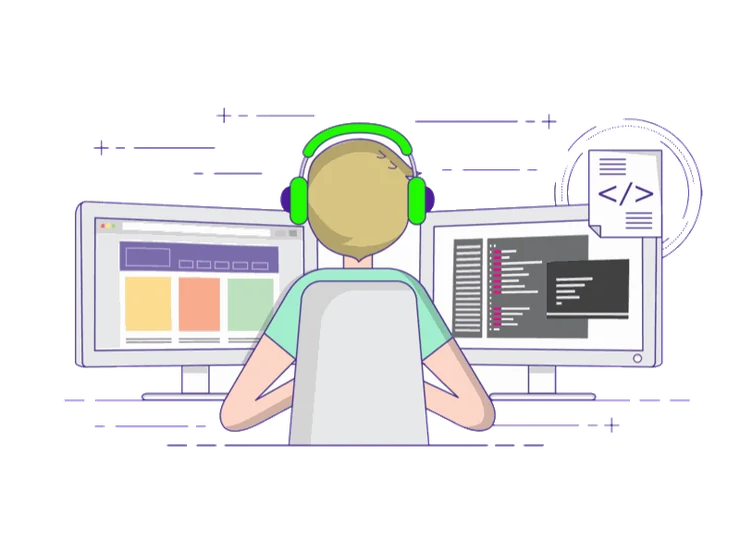

<!-- ============================================================= -->
<!--                    HEADER / HERO BANNER                       -->
<!-- ============================================================= -->

  

  

<!-- Profile views + follow button + main badges -->

  
  
  
  
  
  

 

<!-- ============================================================= -->
<!--                         ABOUT ME                              -->
<!-- ============================================================= -->

### 🧑‍💻 &nbsp;About Me

- 🚀 &nbsp;**Software Developer @ Smart Technology** — Engineering forward-deployed CPaaS, AI agent tooling, and cloud platforms.
- 🛡️ &nbsp;**AI & Agent Security Researcher** — Focused on Model Context Protocol (MCP) servers & agentic security: tool poisoning, schema poisoning, confused-deputy attacks, and prompt misuse.
- 🔑 &nbsp;**OAuth & IAM Architecture** — Architected unified OAuth hubs across 6+ platforms (Zoho, HubSpot, Shopify, Razorpay) and multi-channel pipelines (WhatsApp, SMS, RCS).
- 🤖 &nbsp;**GenAI & RAG Systems** — Implemented production RAG pipelines with Python, PyTorch, HuggingFace Transformers, vLLM, pgvector, and LangGraph orchestration.
- 🌐 &nbsp;**Founder & Builder at [automatlog.in](https://automatlog.in)** — Shipping production platforms, web applications, and security tooling for client ecosystems.
- 🎓 &nbsp;**B.Tech CSE (Cybersecurity & Networking)** — ITM-SLS Baroda University · Vadodara, Gujarat 🇮🇳
- 🤝 &nbsp;**Community Leadership** — Management Lead @ GDSC ITMBU · Student Ambassador @ DeepLearning.AI · AWS User Group Vadodara.
- 📫 &nbsp;Reach me via [LinkedIn](https://linkedin.com/in/amandkyadav) or explore my portfolio at **[automatlog.in](https://automatlog.in)**.

 

<!-- ============================================================= -->
<!--                      SECTION DIVIDER                          -->
<!-- ============================================================= -->

  

<!-- ============================================================= -->
<!--                    VERIFIED CERTIFICATIONS                    -->
<!-- ============================================================= -->

### 📜 &nbsp;Verified Certifications & Credentials

<table align="center" width="100%">
  <tr>
    <td align="center" width="50%">
      
       
      <b>Sep 2024</b> · Credential ID: <code>862B527704C9AF53</code>
    </td>
    <td align="center" width="50%">
      
       
      <b>SkillFront · Sep 2023</b> · Credential ID: <code>78282553463382</code>
    </td>
  </tr>
  <tr>
    <td align="center" width="50%">
      
       
      <b>Top 5% Contributor</b> · Credential: <code>THM-WSLWBW9LUG</code>
    </td>
    <td align="center" width="50%">
      
       
      <b>Govt. of India</b> · Credential: <code>MeitY/ISEA/WCHP/030049</code>
    </td>
  </tr>
  <tr>
    <td align="center" width="50%">
      
       
      <b>Foundations of Operationalizing MITRE ATT&CK</b>
    </td>
    <td align="center" width="50%">
      
       
      <b>Google Cloud Study Jam & Foundations</b>
    </td>
  </tr>
</table>

  

<!-- ============================================================= -->
<!--                       TECH STACK                              -->
<!-- ============================================================= -->

### 🧰 &nbsp;Tech Stack & Core Competencies

<table align="center" width="100%">
  <tr>
    <td align="center" width="160">
      <strong>Application Security & Pentesting</strong>
    </td>
    <td>
      
      &nbsp;
      
      
      
      
      
    </td>
  </tr>
  <tr>
    <td align="center" width="160">
      <strong>AI, Agents & Security</strong>
    </td>
    <td>
      
      &nbsp;
      
      
      
      
      
    </td>
  </tr>
  <tr>
    <td align="center" width="160">
      <strong>Cloud, DevOps & SOC</strong>
    </td>
    <td>
      
      &nbsp;
      
    </td>
  </tr>
  <tr>
    <td align="center" width="160">
      <strong>Languages</strong>
    </td>
    <td>
      
    </td>
  </tr>
  <tr>
    <td align="center" width="160">
      <strong>Frameworks & Mobile</strong>
    </td>
    <td>
      
      &nbsp;
      
      
      
    </td>
  </tr>
  <tr>
    <td align="center" width="160">
      <strong>Databases</strong>
    </td>
    <td>
      
    </td>
  </tr>
  <tr>
    <td align="center" width="160">
      <strong>Developer Tools & UI</strong>
    </td>
    <td>
      
    </td>
  </tr>
</table>

  

<!-- ============================================================= -->
<!--                    FEATURED PROJECTS                          -->
<!-- ============================================================= -->

### 🚀 &nbsp;Featured Projects & Engineering Work

<table>
  <tr>
    <td width="50%" valign="top">
      <h3>🤖 Automate &nbsp;<code>2026</code></h3>
      
AI-agent automation platform featuring a <b>visual chatbot builder</b>, multi-agent orchestration with an intelligent routing layer, centralized management console, embeddable widgets, human-like face agents, and adaptive interaction-based learning.

      

        
        
        
        
      

    </td>
    <td width="50%" valign="top">
      <h3>🛡️ AI Agent & MCP Security Research &nbsp;<code>2026</code></h3>
      
Independent threat-modeling research on <b>Model Context Protocol (MCP)</b> servers in agentic AI. Auditing tool poisoning, schema manipulation, confused-deputy attack surfaces, and tool-permission misuse mapped directly to CVEs and MCP specifications.

      

        
        
        
        
      

    </td>
  </tr>
  <tr>
    <td width="50%" valign="top">
      <h3>📱 AI Connector &nbsp;<code>2026</code></h3>
      
CPaaS solution delivered on <b>Android & iOS (React Native, Expo)</b> with webhook-driven WhatsApp, SMS, and RCS pipelines, WebRTC voice signaling over FreeSWITCH, and consolidated OAuth 2.0 multi-provider token management.

      

        
        
        
        
      

    </td>
    <td width="50%" valign="top">
      <h3>🔍 OSINT Security Suite &nbsp;<code>2026</code></h3>
      
Full-stack OSINT reconnaissance and threat scanning platform built with <b>React & Python</b>. Features automated intelligence gathering, dynamic PDF threat reporting pipelines, and zero-plaintext credential handling with environment-based secret isolation.

      

        
        
        
        
      

    </td>
  </tr>
  <tr>
    <td width="50%" valign="top">
      <h3>🧬 Protein-Ligand Docking Pipeline &nbsp;<code>2026</code></h3>
      
Automated molecular docking pipeline for computational drug-discovery research utilizing <b>AutoDock-GPU, AutoDock4, OpenBabel, GNINA, and RDKit</b> with AI-assisted binding-site detection, automated ligand prep, and result scoring.

      

        
        
        
        
      

    </td>
    <td width="50%" valign="top">
      <h3>🔐 <a href="https://github.com/automatlog/cRYpToGRaphY">cRYpToGRaphY</a> & CTF Security Labs</h3>
      
Open-source repository of cryptographic ciphers, encoding/decoding implementations, CTF vulnerable lab challenges, and offensive security tooling tested across TryHackMe and PortSwigger Web Security Academy.

      

        
        
        
        
      

    </td>
  </tr>
  <tr>
    <td colspan="2" valign="top">
      <h3>🛒 Shopify/Ecommerce Automation</h3>
      
Commerce automation across <b>Shopify and WooCommerce</b>: a Shopify App Store app that brings messaging to merchants (Remix + Polaris), a WooCommerce plugin sending automated order notifications for 4 live stores, and custom Shopify storefronts built on Liquid.

      

        
        
        
        
      

    </td>
  </tr>
</table>

 

  
<b>🌐 &nbsp;Client Web Projects</b>

   
  <table align="center">
    <tr>
      <td align="center"></td>
      <td align="center"></td>
    </tr>
    <tr>
      <td align="center"></td>
      <td align="center"></td>
    </tr>
  </table>

  

<!-- ============================================================= -->
<!--                  CONTRIBUTION SNAKE                           -->
<!-- ============================================================= -->

  <picture>
    <source media="(prefers-color-scheme: dark)" srcset="https://raw.githubusercontent.com/automatlog/automatlog/output/github-contribution-grid-snake-dark.svg" />
    <source media="(prefers-color-scheme: light)" srcset="https://raw.githubusercontent.com/automatlog/automatlog/output/github-contribution-grid-snake.svg" />
    
  </picture>

  

<!-- ============================================================= -->
<!--                          SIGN-OFF                             -->
<!-- ============================================================= -->

  <i>"💭 Alive & Well Functioning...!"</i>

<!-- ============================================================= -->
<!--                          FOOTER                               -->
<!-- ============================================================= -->

  

